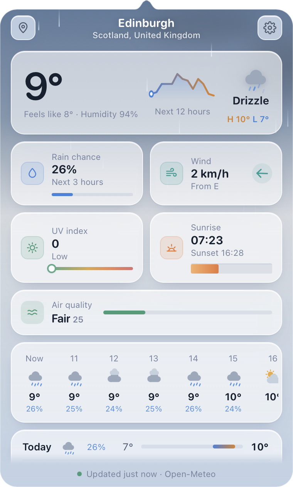
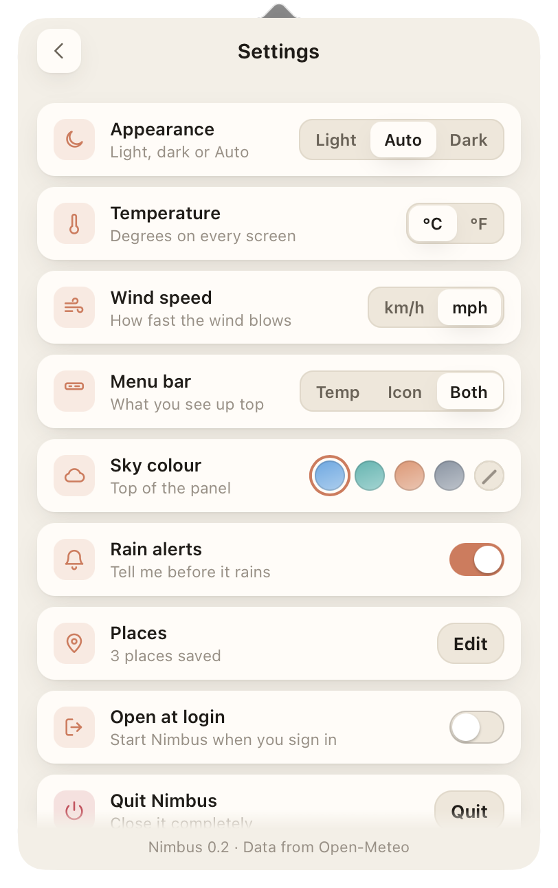

# Nimbus

Weather in your menu bar, with a sky that moves. Free, no account, no tracking.



## What it does

- Live forecast from [Open-Meteo](https://open-meteo.com): now, the next 12 hours, hourly and the next 10 days.
- Unlimited saved places, plus your current location.
- Rain chance, wind with a direction arrow, UV scale, sunrise and sunset, air quality.
- A soft sky that follows the weather and the time of day. Pick blue, teal, warm, slate or none.
- A rain alert before it rains. Units follow your Mac's region.
- Menu bar shows the icon, the temperature, or both. Light, dark or automatic. Open at login.
- Works offline with the last forecast. A Windows tray version is included.



## Download

Mac (macOS 14 or later, Apple silicon): [Nimbus.dmg](https://github.com/Solomon-69/Nimbus/releases/latest/download/Nimbus.dmg). Signed and notarized by Apple.
Windows 10 or 11: [Nimbus-windows.zip](https://github.com/Solomon-69/Nimbus/releases/latest/download/Nimbus-windows.zip).

Or on a Mac, paste this into Terminal:

```bash
curl -fsSL https://solomon-69.github.io/Mac-Apps/download/install.sh | bash -s nimbus
```

## Privacy

Your location stays on your device. Only rough coordinates are sent to Open-Meteo to look up the weather. No account, no analytics. Windows can fall back to an approximate place from your network address if Windows location is off.

## Build it yourself

```bash
./build.sh          # Mac app, installs to ~/Applications
./release.sh        # signed and notarized release (needs a Developer ID and a notary profile)
```

The screens are plain web files in `web/`, shared by the Mac shell (`Sources/`, Swift) and the Windows shell (`windows/`, C# with WebView2). See `PROGRESS.md` for the build history.

## Licence

MIT. See `LICENSE`.
